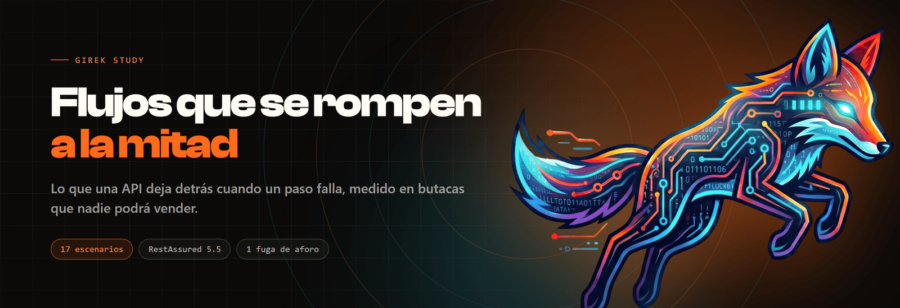

<p>
  
  
  
  
  
</p>

Pruebas de **flujos de negocio** con RestAssured y JUnit 5: 17 escenarios que no comprueban
qué responde cada endpoint, sino **qué deja el sistema cuando la secuencia se tuerce**. Trae
su propia API de reservas, que pierde butacas cada vez que falla un pago, y un CI que exige
que la suite lo detecte.

No hace falta instalar Java ni Maven: el repositorio trae su propio contenedor.

```bash
git clone https://github.com/Girek-Study/restassured-api-flows.git
cd restassured-api-flows

docker compose run --rm pruebas                    # API que pierde aforo
API_CORREGIDA=1 docker compose run --rm pruebas    # API que compensa
```

```
InterrupcionDelFlujoTest.siElPagoFallaElAforoVuelve » ConditionTimeout
  Un pago que falla no puede quedarse con las butacas.
  Son asientos que nadie compró y que nadie podrá comprar:
  el 500 le dijo al cliente que la operación no se hizo.
  ==> expected: <47> but was: <45> within 15 seconds.

Tests run: 17, Failures: 0, Errors: 1, Skipped: 0
BUILD FAILURE
```

**Ese `BUILD FAILURE` es el resultado bueno.** Con `API_CORREGIDA=1`, la misma suite sin
tocar una línea:

```
Tests run: 17, Failures: 0, Errors: 0, Skipped: 0
BUILD SUCCESS
```

---

## El defecto que ninguna respuesta delata

El flujo tiene tres pasos y cada uno mueve butacas:

```
                POST /reservas            POST .../pago          POST .../emision
   (nada)  ────────────────────▶ BLOQUEADA ──────────▶ PAGADA ──────────────▶ EMITIDA
                                     │
                     DELETE          │
                     o caducidad     ▼
                               ANULADA / EXPIRADA
```

Si el cobro revienta **después** de que la reserva pase a `PAGADA`, el cliente recibe un 500
y da la compra por no hecha. Las butacas, en cambio, están vendidas: ya no son un bloqueo,
así que la caducidad —que solo mira los bloqueos— no las toca nunca.

```
aforo antes del flujo          disponible 10
POST /reservas (3 butacas)  →  201, disponible 7   (bloqueadas)
POST .../pago               →  500 ERROR_INTERNO
aforo después                  disponible 7        ← no vuelve
y pasado el bloqueo            disponible 7        ← tampoco
```

Tres asientos que nadie compró y que nadie podrá comprar. En un evento de 200 butacas con un
uno por ciento de pagos fallidos son dos entradas por tanda, y **nadie lo relaciona con la
pasarela**: el día del concierto sobran butacas vacías y en el informe de ventas no falta
nada.

Lo que lo hace invisible es que **ninguna respuesta por separado está mal**. El 500 es
correcto: el cobro falló de verdad. El aforo responde 200 con un número perfectamente
válido. Hay que comparar el aforo de antes con el de después, y eso solo lo hace quien prueba
flujos.

## La pareja de casos que justifica el repositorio

`IN-03` hace fallar el **pago**. `IN-04` hace fallar la **emisión**. Los dos reciben el mismo
500 con el mismo cuerpo, y significan lo contrario:

| | IN-03 · falla el pago | IN-04 · falla la emisión |
| --- | --- | --- |
| Respuesta | `500 ERROR_INTERNO` | `500 ERROR_INTERNO` |
| Lo correcto | **el aforo vuelve** | el aforo **sigue consumido** |
| Por qué | el cliente cree que no compró | la butaca está pagada |
| Qué puede hacer | nada, y se quedó sin butacas | reintentar la emisión |

Un escenario que juzgue por la respuesta da los dos por iguales. La diferencia existe
únicamente en el estado de después.

Por eso todas las aserciones de esta suite miran el mismo número, a los dos lados del flujo:

```java
int antes = disponibleEn(EVENTO_GRANDE);
// ... el flujo, con su interrupción ...
assertEquals(antes, disponibleEn(EVENTO_GRANDE));
```

Y es un **delta, nunca un número fijo**. Así el escenario sigue valiendo cuando otro venda
butacas antes, y no hace falta reiniciar el servidor entre pruebas — que es la mitigación que
funciona en el equipo de quien la escribe y falla en el de todos los demás.

## Antes del código: el trabajo de calidad

| | |
| --- | --- |
| [Análisis de flujos](docs/01-analisis-de-flujos.md) | La **invariante de aforo**, y las cuatro formas de no llegar al final |
| [Diseño de casos](docs/02-diseno-de-casos.md) | Los 17 escenarios y las cuatro técnicas |
| [Matriz de trazabilidad](docs/03-matriz-trazabilidad.md) | 31 reglas, 26 con caso — y las **5 sin ninguno**, con su motivo |
| [Análisis de riesgos](docs/04-analisis-riesgos.md) | Cinco riesgos. El primero es que la suite se vuelva intermitente |
| [Hallazgos](docs/05-hallazgos.md) | **Cuatro.** Uno lo puse yo. Tres no |

### El hallazgo que más me interesa no está en la API

Está en el control que la vigila. La aserción de IN-03 vive dentro de un `untilAsserted` de
Awaitility, así que cuando falla llega como excepción y **surefire la cuenta en `Errors`, no
en `Failures`**. El CI contaba solo `Failures`, leía un cero, y habría fallado diciendo:

> `::error::Se esperaba 1 escenario en rojo y hubo 0.`

Es decir: **habría acusado a la suite de no detectar nada en la misma corrida en la que
detectó exactamente lo que tenía que detectar.** Y el diagnóstico obvio ante ese mensaje —«la
aserción está mal, la reescribo»— es cómo se desmonta un control que funciona.

Está corregido sumando las dos columnas, y con una comprobación de más: que el escenario en
rojo **sea IN-03**. Un control que no distingue un acierto de una casualidad no es un
control.

## El CI, y por qué tiene dos trabajos

| Trabajo | API | Exige |
| --- | --- | --- |
| **`detecta-la-fuga`** | sin compensación | que **falle**, con **1 rojo**, y que ese rojo sea **IN-03** |
| **`no-miente`** | con compensación | que **pase entera** |

El segundo lo tiene todo el mundo. El primero casi nadie, y sin él no hay ninguna evidencia
de que la suite funcione: **el verde de una suite vacía y el de una suite completa son el
mismo pixel**.

```bash
# Failures Y Errors: Awaitility lanza una excepción, no un AssertionError.
FALLOS=$((F + E))
if [ "$FALLOS" != "1" ]; then exit 1; fi

# Y que sea EL escenario, no otro cualquiera.
grep -q 'siElPagoFallaElAforoVuelve' corrida.log || exit 1
```

## Tres decisiones que lo sostienen

**1. Esperar a una condición, no a un reloj.**

Dos escenarios dependen de que caduque un bloqueo. `Thread.sleep(4000)` es **lento cuando
acierta** —espera los cuatro segundos aunque el evento ocurra en uno— y **mentiroso cuando
no**: en una máquina cargada termina antes que el evento y la prueba falla por el reloj. Y un
fallo por reloj se arregla relanzando, así que nadie lo investiga y la suite aprende a
mentir.

```java
await().atMost(Duration.ofSeconds(15)).pollInterval(Duration.ofMillis(300))
       .untilAsserted(() -> assertEquals(antes, disponibleEn(EVENTO_GRANDE)));
```

**2. Exigir el resultado, no la implementación.**

Hay **dos formas correctas** de devolver el aforo tras un pago fallido: revertir a
`BLOQUEADA` y dejar que caduque, o liberar en el acto. IN-03 no exige ninguna de las dos:
espera a que el aforo vuelva. Exigir una implementación concreta convierte la suite en un
freno, y el día que alguien cambie la compensación legítimamente el equipo edita la prueba
para que vuelva a pasar. Después de hacer eso dos veces, nadie se cree el rojo siguiente.

Lo mismo en SV-03, el escenario concurrente: comprueba la invariante `aceptadas <=
disponibles` y **no cuáles de las cinco peticiones ganan**. Exigir un ganador en una carrera
da una prueba que falla una de cada veinte veces.

**3. Esperar al estado inicial en vez de ordenar las pruebas.**

Las tres pruebas de aforo comparten el evento pequeño y JUnit no garantiza su orden. La
salida cómoda es `@Order`; la que está es esperar a tener el evento entero. **Ordenar las
pruebas esconde el acoplamiento; esperar lo resuelve**, y deja la suite lista para el día que
alguien añada un caso en medio.

## Cómo se organiza

```
demo/
  servidor.js             la API de reservas. Node, sin dependencias
src/test/java/study/girek/flujos/
  BaseDeFlujo.java        sesión, aforo y el paso 1, para que un flujo se lea como un flujo
  FlujoCompletoTest.java  FL-01, FL-02   el camino feliz
  InterrupcionDelFlujoTest.java  IN-01…IN-04   qué queda cuando no termina
  IdempotenciaTest.java   ID-01…ID-03    el reintento que nadie prueba
  ReglasDeEstadoTest.java ES-01…ES-05    los pasos en orden equivocado
  SobreventaTest.java     SV-01…SV-03    aforo y concurrencia
docs/                     el trabajo de calidad: 5 documentos
docker-compose.yml        la API y Maven 3.9 con Java 17, sin instalar nada
```

**La suite es secuencial a propósito.** Todos los escenarios tocan el mismo inventario: dos a
la vez sobre el mismo evento se restan butacas entre ellos y el fallo aparece en el escenario
equivocado. Lo que se ahorraría paralelizando son segundos; lo que costaría es una suite que
falla a veces, y una suite que falla a veces se relanza hasta que pase.

## Correrlo sin Docker

Si ya tienes Java 17 y Maven:

```bash
npm run api                      # la API de ejemplo, en otra terminal
npm run api:corregida            # o la versión que compensa
mvn test -Dapi.url=http://localhost:8095
```

El puerto es el **8095** y no el 8080 a propósito: el 8080 es el puerto más ocupado de
cualquier equipo de desarrollo, y un servicio ajeno que responda 200 con HTML hace que las
primeras comprobaciones vayan contra otro sitio sin que nada lo diga.

## Credenciales y datos

| Usuario | Clave | Rol |
| --- | --- | :-: |
| `taquilla` | `taquilla-2026` | `VENDEDOR` |
| `auditoria` | `auditoria-2026` | `AUDITOR` |

Son de la API de ejemplo, que vive dentro del repositorio y no sale a internet. Los
asistentes son **correlativos sintéticos** (`AST-0001`), no documentos de identidad.

## Los otros repositorios de esta serie

| | |
| --- | --- |
| [`karate-api-contract`](https://github.com/Girek-Study/karate-api-contract) | **API · contrato**: ¿la respuesta es la que prometió el OpenAPI? |
| [`screenplay-web-bdd`](https://github.com/Girek-Study/screenplay-web-bdd) | Web con Screenplay, Cucumber y Playwright |
| [`screenplay-mobile-bdd`](https://github.com/Girek-Study/screenplay-mobile-bdd) | Móvil con Appium y WebdriverIO |
| [`k6-performance-suite`](https://github.com/Girek-Study/k6-performance-suite) | Carga con k6, dos informes por corrida |

La primera fila es la que conviene leer al lado de esta. **Son dos preguntas distintas sobre
la misma capa**: allí, si la respuesta cumple lo prometido; aquí, qué queda cuando la
secuencia se rompe. Hacen falta las dos, y ninguna cubre lo de la otra.

## Licencia

MIT. Ver [LICENSE](LICENSE).

---

[girek-study.com](https://girek-study.com)
